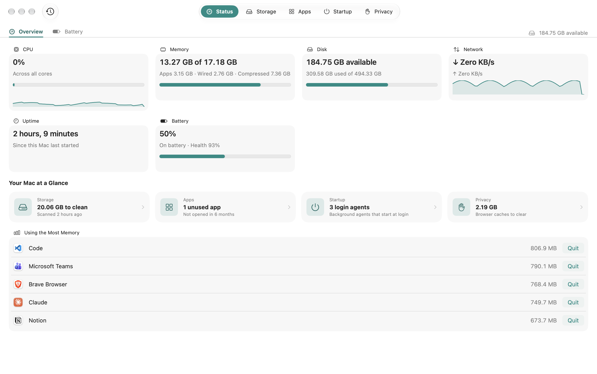
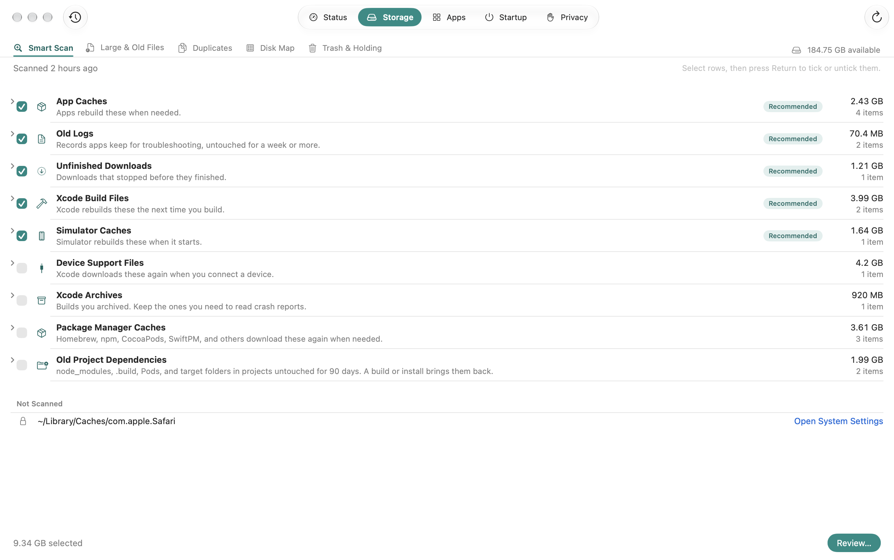
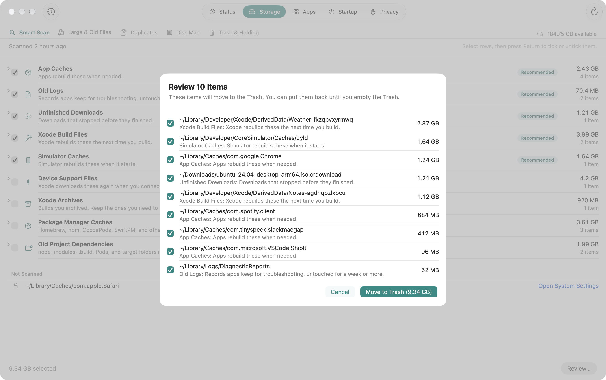
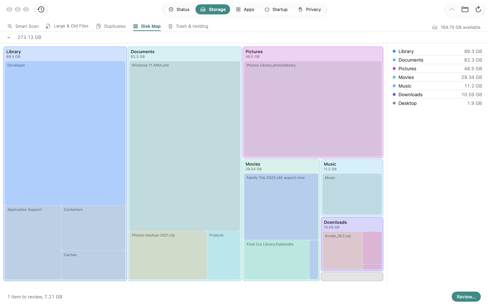
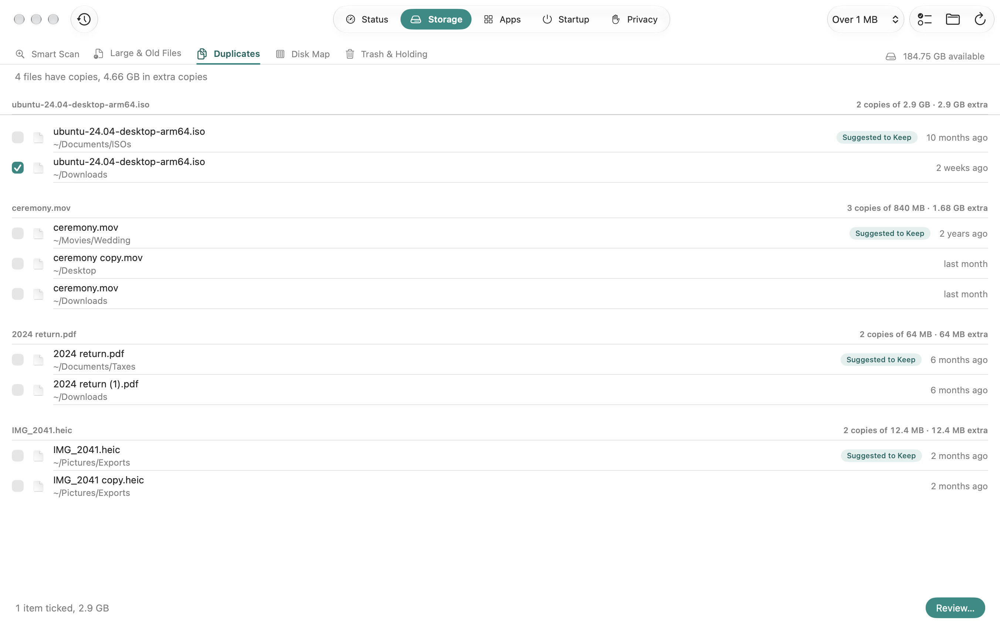
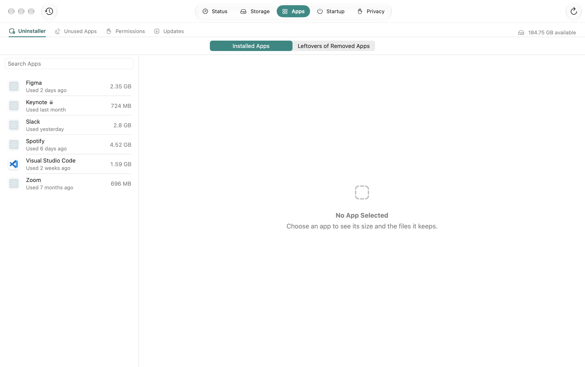
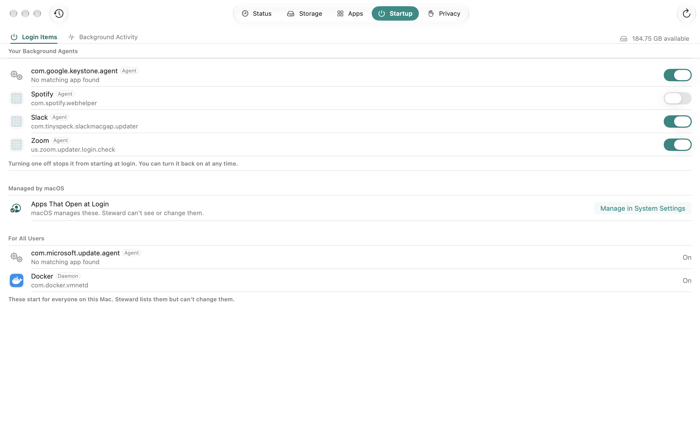

<div align="center">


# Steward

**A calm, native macOS app to clean, inspect, and tidy your Mac.**

[](https://github.com/periiyasami/steward-mac/releases/latest)


</div>

<picture>
  <source media="(prefers-color-scheme: dark)" srcset="screenshots/status-dark.png">
  
</picture>

Steward brings storage cleanup, app management, startup items, and privacy housekeeping together in one
native SwiftUI app. It runs entirely on your Mac — no account, no server, no telemetry — and it never deletes
anything without showing you first.

## Features

| Module | What you can do |
| --- | --- |
| **System Status** | Live CPU, memory, disk, and battery status, with a summary of every module. |
| **Storage** | Smart Scan for caches, logs, and other safe-to-remove clutter · Large & Old Files · Duplicates · an interactive Disk Map · a Trash & Holding area for recent removals. |
| **Apps** | Uninstall apps together with their leftovers · find unused apps · review privacy permissions · check for app updates (Sparkle, Homebrew, GitHub, Electron). |
| **Startup & Background** | List login items and launch agents with the apps that own them; switch user agents off and on. |
| **Privacy** | Clear browser data and recent-items lists. |
| **History** | A record of everything Steward has cleaned and how much space it freed. |

### Built to be safe

- **Review before removal.** Every clean-up opens a Review sheet; nothing moves until you confirm.
- **Trash, never delete.** Items go to the Trash — or to an optional holding area that keeps them for 7 days (configurable) before removing them for good.
- **Undo.** Changed your mind? Edit → Undo (⌘Z) puts the last clean-up back where it was.
- **Guard rails.** Steward only touches items inside your home folder (plus third-party apps in `/Applications`), never your top-level folders, and never follows symlinks to their targets.
- **Private by default.** Your data stays in a local SwiftData store. The update checker is the only feature that uses the network, and it is off until you turn it on.

## Screenshots

<table>
<tr>
<td width="50%" valign="top">

<picture>
  <source media="(prefers-color-scheme: dark)" srcset="screenshots/scan-results-dark.png">
  
</picture>

<sub><b>Smart Scan — caches, logs, and leftovers, grouped and sized</b></sub>
</td>
<td width="50%" valign="top">

<picture>
  <source media="(prefers-color-scheme: dark)" srcset="screenshots/review-dark.png">
  
</picture>

<sub><b>Review — every item is checked before anything moves</b></sub>
</td>
</tr>
<tr>
<td width="50%" valign="top">

<picture>
  <source media="(prefers-color-scheme: dark)" srcset="screenshots/diskMap-dark.png">
  
</picture>

<sub><b>Disk Map — see what fills your disk and drill in</b></sub>
</td>
<td width="50%" valign="top">

<picture>
  <source media="(prefers-color-scheme: dark)" srcset="screenshots/duplicates-dark.png">
  
</picture>

<sub><b>Duplicates — identical files, matched by content</b></sub>
</td>
</tr>
<tr>
<td width="50%" valign="top">

<picture>
  <source media="(prefers-color-scheme: dark)" srcset="screenshots/uninstaller-dark.png">
  
</picture>

<sub><b>Uninstaller — remove apps along with their leftovers</b></sub>
</td>
<td width="50%" valign="top">

<picture>
  <source media="(prefers-color-scheme: dark)" srcset="screenshots/loginItems-dark.png">
  
</picture>

<sub><b>Login Items — see and switch off what starts with your Mac</b></sub>
</td>
</tr>
</table>

<sub>Screenshots use built-in sample data and follow your GitHub light/dark theme.</sub>

## Requirements

- macOS 26 (Tahoe) or later
- Apple silicon or Intel Mac

## Installation

1. Download **`Steward-<version>.dmg`** from the [latest release](https://github.com/periiyasami/steward-mac/releases/latest).
2. Open the DMG and drag **Steward** onto the **Applications** folder.
3. Allow the app to open (see below) — required once, because Steward is not notarized.

### Allowing an unsigned app to open

Steward is distributed with an ad-hoc signature rather than an Apple Developer ID, so on first launch macOS
shows *“Steward” Not Opened* (or *“Apple could not verify…”*). This is expected. To allow it:

**Option A — System Settings (recommended)**

1. Open **Steward** from Applications. When the warning appears, click **Done** (not *Move to Trash*).
2. Open **System Settings → Privacy & Security**.
3. Scroll to the **Security** section. Next to *“Steward” was blocked to protect your Mac*, click **Open Anyway**.
4. Confirm with **Open Anyway** again and authenticate with Touch ID or your password.

macOS remembers this choice; you only need to do it once per version.

**Option B — Terminal**

Remove the download quarantine flag, then open the app normally:

```sh
xattr -dr com.apple.quarantine /Applications/Steward.app
```

> [!NOTE]
> On recent versions of macOS, Control-clicking the app and choosing **Open** no longer bypasses this check — use one of the options above.
> If you prefer not to run an un-notarized build, you can [build Steward from source](#building-from-source) instead.

### Granting Full Disk Access (optional, recommended)

Some features — privacy permissions, other apps’ caches, and protected Library folders — need Full Disk Access.
Steward will tell you when a page needs it.

1. Open **System Settings → Privacy & Security → Full Disk Access**.
2. Click **+**, choose **Steward** from Applications, and switch it on.
3. Quit and reopen Steward.

Steward only reads these locations to show them to you; it never moves anything without a review.

## Building from source

Steward is a Swift package — there is no Xcode project.

**Prerequisites:** macOS 26 and Xcode 26 (or later).

```sh
git clone https://github.com/periiyasami/steward-mac.git
cd steward-mac
./build.sh --open          # builds, signs, installs to ~/Applications/Steward.app, and launches it
```

`build.sh` signs with your Apple Development certificate if one is installed, otherwise ad hoc. Build products
live in `~/Library/Developer/Steward`, outside the repository.

| Task | Command |
| --- | --- |
| Unit tests | `swift test --scratch-path ~/Library/Developer/Steward/test-build` |
| End-to-end self-test (on a throwaway store in `/tmp`) | `tools/selftest.sh` |
| Snapshots of every page, light and dark | `tools/snap.sh` |
| Refresh the README screenshots | `tools/readme-shots.sh` |
| Package a shareable DMG | `tools/make-dmg.sh` |

To produce a notarizable build, pass a Developer ID identity:
`SIGN_IDENTITY="Developer ID Application: …" tools/make-dmg.sh`.

## Project structure

```
Sources/
  Steward/        SwiftUI app — windows, pages, settings, menu bar
  StewardKit/     Scanning, cleaning, and safety rules (no UI; fully unit-tested)
Tests/
  StewardKitTests/
Icon/             App icon (Icon Composer)
tools/            Build, packaging, snapshot, and lint scripts
```

## Contributing

Issues and pull requests are welcome. Please run the unit tests and `tools/selftest.sh` before opening a PR,
and include light and dark screenshots for UI changes.

## Disclaimer

Steward moves files to the Trash on your behalf. It is designed to be conservative and every action is
reviewable and reversible, but you use it at your own risk. Keep a current Time Machine backup.
